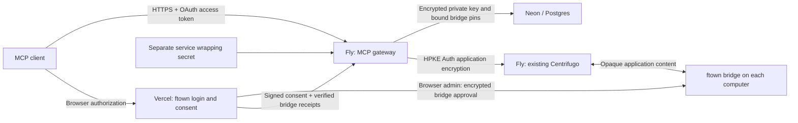

# HTTPS MCP gateway

ftown exposes MCP as a remote **Streamable HTTP endpoint over HTTPS**, with OAuth authorization through the existing ftown login. There is no MCP stdio mode.

## Deployment architecture



The gateway is a **separate Fly app**, alongside the existing `ftown-centrifugo` app. Its public URL ends in `/mcp`. Fly terminates TLS; the container listens on its internal HTTP port. The existing Vercel UI hosts `/mcp/consent` and reuses the current NextAuth login. OAuth state lives in the same Postgres database as ftown's users and device ownership records.

Computers connect outward to Centrifugo. The `relay` transport needs no inbound
ports or SSH credentials. Upgraded gateway and bridge endpoints use HPKE Auth
application encryption (P-256, HKDF-SHA256, AES-256-GCM) with explicitly approved
identities and pinned bridge keys. Legacy plaintext HTTP/SSH and `bridge_exec`
compatibility paths cannot bypass this boundary; upgrade and pair those workers.
Timeouts and ambiguous failures never trigger a fallback or mutation retry.

The hosted gateway is a trusted plaintext endpoint: standard MCP clients use
HTTPS/OAuth and the gateway reads tool calls/results. Every grant has a distinct
bridge-facing key, stored as authenticated ciphertext with its pins in Postgres.
A separately provisioned service secret wraps that record. The approving browser
sends encrypted grants to selected bridges; the gateway validates bridge receipts
before completing consent. Grants are initially pending, activate only after a
valid access-token request, and never exceed the browser-approved expiry. No
model PIN or custom MCP client is required. Routing IDs, hostname, sizes/timing,
public keys and online state remain visible metadata. See the complete
[encryption diagram](../README.md#architecture) and [operations guide](e2ee-operations.md).

## Deployment checklist

The production gateway is `https://ftown-mcp.fly.dev/mcp`, in Fly organization `ftown`. The consent page is deployed to `https://ftown.ia.br/mcp/consent` in the existing Vercel project. The initial rollout applied migration `0004_mcp_oauth.sql` and registered four paired computers belonging to the owner of the configured anchor bridge. The compatibility rollout (`0c67792`, gateway 0.19.35) verified three available computers and 27 running sessions. Foad-Legion remains unreachable. A live disposable MCP session passed creation, terminal input, history/search, mail enqueue/readback, stop/retry and removal. See the [investigation](investigations/2026-10-10-mcp-legacy-bridges.md).

The historical production evidence below predates endpoint encryption and is
not validation of the encrypted rollout. Before deploying this protocol, apply
`ui/migrations/0006_endpoint_security.sql` after the existing OAuth migration,
provision `FTOWN_MCP_KEY_ENCRYPTION_SECRET` and its configured key ID outside the
database, and upgrade/pair each bridge. Preserve that wrapping secret during
redeployment; a missing or wrong key fails closed and must never regenerate an
identity. Existing MCP clients require renewed consent from an approved browser.

The following steps describe setup and recovery:

1. Apply `ui/migrations/0004_mcp_oauth.sql` using the existing migration workflow. It adds one table and an expiry index. The fresh-install `ui/schema.sql` includes the same definitions.
2. Deploy the UI changes to its existing Vercel project with these server-only environment variables:
   - `FTOWN_PUBLIC_URL`: canonical ftown UI HTTPS origin, e.g. `https://ftown.ia.br`, without a trailing slash.
   - `FTOWN_MCP_PUBLIC_URL`: canonical gateway HTTPS origin, e.g. `https://ftown-mcp.fly.dev`, without a trailing slash.
   - `FTOWN_MCP_APPROVAL_SECRET`: a new random secret of at least 32 characters, shared only with the gateway. Do not reuse the NextAuth or Centrifugo key.
3. Configure the gateway using `deploy/mcp/gateway.example.json`. Each machine `id` is its actual ftown bridge ID; `userId` is the bridge owner's account email. Each access `subject` is the immutable `users.id`, not an email address. The configured access list is an additional restriction: current database device ownership and revocation are also checked at consent and on every authenticated MCP request.
4. Set Fly secrets through your secret manager or Fly's secret input mechanism:
   - `FTOWN_MCP_CONFIG_JSON`: the complete gateway JSON config, or use `FTOWN_MCP_CONFIG` to name a mounted file.
   - `DATABASE_URL`: the existing ftown Postgres database with the OAuth migration applied.
   - `FTOWN_MCP_APPROVAL_SECRET`: the same new secret as the UI.
   - `CENTRIFUGO_URL`: existing relay's `wss://…/connection/websocket` URL.
   - `CENTRIFUGO_TOKEN_SECRET`: existing relay signing key, needed to create short-lived owner-scoped relay connections. OAuth access tokens are never forwarded to Centrifugo.
5. Build/deploy from the repository root using the new app's config, after confirming the deployment target:

```sh
fly deploy --config deploy/mcp/fly.toml --ignorefile deploy/mcp/.dockerignore
```

6. Upgrade/restart the computer bridges with this build. Verify `/healthz`, OAuth discovery, and an end-to-end grant against a test account before enabling production users.

`deploy/mcp/Dockerfile` builds only the gateway's runtime requirements; PTY/WebRTC native install scripts are skipped because the hosted process does not launch agents locally. The runtime is non-root. The Fly config requires HTTPS, keeps one instance warm, and has a liveness check.

The `Deploy HTTPS MCP gateway to Fly` workflow uses the app-scoped `FLY_MCP_API_TOKEN`, separate from the broker's deploy token. It takes the database and broker credentials from existing GitHub secrets and shares `FTOWN_MCP_APPROVAL_SECRET` with the production Vercel project. `FTOWN_MCP_OWNER_BRIDGE_ID` identifies an existing, non-revoked bridge; deployment derives only that owner's active computers from the database. Re-run the workflow after pairing another computer to refresh the gateway registry. Rotate the app deploy token before its 30-day expiry. Never print or upload the generated runtime secret bundle.

Initial deployment evidence: [database migration](https://github.com/fmktech/ftown/actions/runs/38008247315), [gateway build, tests and deployment](https://github.com/fmktech/ftown/actions/runs/38008464435). The gateway image was built from `5ebbdf2`; the production consent UI was built from `3c442a2`.

The live deployment smoke test passed persisted client registration, the login redirect, signed server-to-server consent, S256 PKCE, MCP initialization, read-only tool filtering, refresh rotation, and revocation. Its temporary grant was revoked after testing. This exercised the deployed gateway and production database; it did not exercise an interactive browser login and consent submission. Fleet discovery reached three existing bridges, which rejected the new command; a fourth timed out. A local bridge restart was deferred because its seven direct-runtime agents would be stopped. Upgrade worker bridges before treating fleet control as operational.

For local development behind a TLS reverse proxy:

```sh
cd bridge
npm ci
npm run build
node dist/mcp-cli.js --config /absolute/path/gateway.json
```

The gateway defaults to `127.0.0.1:8080`; the Fly image sets `HOST=0.0.0.0`. Never expose its internal HTTP listener directly to the public internet: the configured ingress is the trusted TLS boundary.

## Connect an MCP client

Add a remote MCP server using your deployed URL:

```text
https://YOUR-MCP-HOST/mcp
```

Use the client's OAuth connection flow. It discovers the authorization server, registers a public client, opens ftown's login/consent page, and exchanges its authorization code using PKCE. The user selects which owned computers to authorize. The consent browser must already have administrator approval on each selected bridge. Offline or unpaired bridges remain visibly blocked; consent cannot silently skip their approval.

There is no local command to launch in the MCP client, and no bridge token to paste into it. Clients must support Streamable HTTP, public OAuth clients with S256 PKCE, and resource indicators. HTTPS browser clients must also have their origin added to `allowedOrigins` in gateway config. Non-browser clients normally omit `Origin`.

## OAuth behavior

- Discovery: `/.well-known/oauth-protected-resource/mcp` and `/.well-known/oauth-authorization-server`; unauthenticated MCP calls return a `WWW-Authenticate` discovery challenge.
- Endpoints: `/register`, `/authorize`, `/token`, `/revoke`. Registration supports public clients (`token_endpoint_auth_method=none`); confidential-client secrets and client-credentials grants are not implemented.
- Authorization uses S256 PKCE, registered redirect validation, explicit browser consent, and a code bound to the client, exact redirect URI, and `/mcp` resource. Codes expire in two minutes and are consumed atomically.
- `mcp:read` allows inspection, history/search, usage and non-consuming inbox observation. `mcp:control` additionally allows session creation/lifecycle, mail sending/broadcast, and terminal input. Write tools are absent from a read-only grant's tool surface, including the mixed-operation batch tool.
- Opaque access tokens expire after 15 minutes. Refresh grants expire after 30 days. Every refresh rotates the refresh token; reuse revokes the entire grant, including issued access tokens. Refresh cannot expand scopes.
- `/revoke` revokes the entire associated grant. Device revocation and configured access removal also prevent subsequent MCP access. Already-dispatched work is not rolled back by revocation.
- Raw OAuth access/refresh tokens and authorization codes are not stored: token records use SHA-256 keys. Account ownership is read from `users` and `bridge_refresh` on every request. Expired records are pruned in bounded batches during ordinary database operations.
- The server sends a 60-second assertion directly to the gateway, bound to audience, issuer, purpose, subject and request. The browser never receives it. Browser-side encrypted bridge approvals produce receipts bound to the exact grant endpoint, selected bridge, permissions and expiry; server completion verifies those receipts before one-use consent succeeds.
- OAuth grants and refresh rotation are shared in Postgres, including transaction locks to serialize refresh rotation. MCP HTTP handling is stateless; it does not require sticky sessions. Connection pools, limits and relay request deduplication remain per process.

The implementation uses the [official MCP SDK](https://ts.sdk.modelcontextprotocol.io/server) for transport and OAuth endpoint handling, following [MCP's HTTP authorization model](https://modelcontextprotocol.io/specification/latest/basic/authorization).

## MCP security activity

Open **Security → Activity** in the dashboard. Gateway evidence includes
authenticated attempts, rejected calls, batches and calls that never reach a
bridge. Select a connected bridge and **Bridge execution** to inspect its
independent received-operation record. Use action IDs to correlate them. A
timeout or unknown outcome is not proof of non-execution; investigate before
repeating a mutation.

History retains 30 days and at most 10,000 events per store. Records contain safe
identity, action, target ID, timestamps and outcome metadata, never raw arguments,
results, tokens, commands, paths or prompt/mail/search text. Gateway history is
available while bridges are offline. Bridge history requires encrypted access.

## Fleet configuration

```json
{
  "publicUrl": "https://ftown-mcp.fly.dev",
  "loginUrl": "https://ftown.ia.br",
  "allowedOrigins": [],
  "fleet": {
    "concurrency": 8,
    "timeoutMs": 15000,
    "machines": [
      {
        "id": "ACTUAL_BRIDGE_ID",
        "label": "Build workstation",
        "transport": "relay",
        "userId": "owner@example.com"
      }
    ]
  },
  "access": [
    { "subject": "USER_DATABASE_ID", "machines": ["ACTUAL_BRIDGE_ID"] }
  ]
}
```

Machine registration is currently explicit, not automatic cloud discovery. Gateway config changes take effect on restart; database device revocation is checked live. Adding a machine requires pairing it to the user's account, adding it to the gateway config, and granting access through OAuth.

Alternative fleet transports remain available: `local` reads the gateway host's bridge credential file; `ssh` runs the private `ftown-mcp --proxy` bridge helper; `http` uses an authenticated HTTPS origin or loopback tunnel and a server-side `tokenEnv`. These are backend transports, not MCP stdio. All machine IDs still have to correspond to owned ftown devices. Relay is the intended hosted default.

## Tools and workflow

| Tool | Purpose |
| --- | --- |
| `whoami` | Verified OAuth account/client/scopes and authorized computers; optional explicit target verification; `self: null` |
| `fleet_overview` | Compact current sessions with computer labels, observed activity, attention support/count/latest excerpt and partial failures |
| `attention_inbox`, `attention_wait` | Non-consuming durable human-input requests and bounded multi-target waiting with reconnect cursors |
| `attention_ack`, `attention_resolve` | Shared delivery acknowledgment or record-only resolution; never answers or approves a CLI prompt |
| `machines_list` | Online computers and current session counts by default; `includeOffline: true` includes unavailable registrations |
| `sessions_list` | Current (running/pending) sessions by default; `status: "all"` includes older sessions, `includeOffline: true` includes connection diagnostics |
| `sessions_create` | Launch a harness with prompt, model, directory and optional parent |
| `sessions_get`, `sessions_update` | Inspect, rename and reparent |
| `sessions_stop`, `sessions_retry` | Stop a process or rerun its stored command |
| `sessions_remove`, `archive_list`, `sessions_revive` | Archive/remove and recreate |
| `sessions_running`, `sessions_usage`, `sessions_wait` | Liveness, usage and bounded status waiting |
| `chats_read`, `chats_search`, `chats_search_fleet` | Retained terminal conversation history and search |
| `messages_send`, `messages_read`, `messages_broadcast` | Durable threaded mail and non-consuming observation |
| `terminal_input`, `terminal_resize`, `terminal_clear` | Exact terminal control |
| `fleet_batch` | Up to 50 independent operations with individual results |

Discover machines → list sessions → create tasks → retain each **machine/session ID pair** → send follow-ups or search/read results → inspect usage and clean up. Broadcast supports up to 200 explicit target pairs. `ftown://guide` provides this workflow to MCP clients. Cron and factory administration remain excluded.

## Identity and durable attention

Start with `whoami`, then `fleet_overview` to select explicit machine/session pairs. The remote gateway knows the authenticated account, client and authorized computers. It cannot read an MCP client's local environment or infer which FTown session is “me”: `self` is always `null`. Passing both `machine` and `sessionId` to `whoami` validates that exact target; it does not install a shared default target.

`fleet_overview` defaults to 25 current sessions, with a maximum of 50, ordered by machine ID then session ID. It returns compact metadata, configured computer labels, hook-observed activity and the newest unresolved attention excerpt. Missing activity is `unknown`; thinking/idle/tool use are observations, not proof of process liveness or task completion. Offline inventory remains visible through `errors`/`omittedOfflineCount`; attention errors on an otherwise available session remain on that row. There is no terminal-history scan.

Bridge 0.19.37 adds a session-local `attention.json` ledger. A supported hook is persisted with an fsynced atomic snapshot before the hook receives HTTP success or the event is published. Gateway outages and bridge/gateway restarts therefore do not erase captured requests. The gateway first probes the existing session route for `capabilities.attention.version: 1`; a missing capability reports `bridge_upgrade_required` before it dispatches any new attention endpoint. Older bridges keep their existing tools. **Installing the new gateway alone does not add capture to an old running bridge**: upgrade/restart each bridge during an appropriate maintenance window. Existing prompts from before the upgrade cannot be reconstructed.

Capture requires a known explicitly addressed or native-mapped session. Ambiguous workspace fallback and unknown sessions do not create authoritative attention. Supported requests are allowlisted `Notification` hooks (`permission_prompt`, `elicitation_dialog`, `agent_needs_input`) and ask-user `PreToolUse` hooks, including namespaced `functions.request_user_input`. Titles/messages are selected plain-text excerpts capped at 200/2000 characters, with terminal controls removed and common credential patterns redacted; arbitrary hook payloads/environment objects are never copied. Excerpts remain untrusted agent output.

Coverage depends on actual harness hooks. Claude's installed hooks include `Notification`; the current Codex installer forwards `PreToolUse`/`PostToolUse` and supports normalized ask-user calls, but does **not** forward general `Notification` events. Authentication failures, permission dialogs or other prompts that produce no supported hook are not detected. Terminal text, idle state and `Stop` are never used to invent attention or task completion.

Read a backlog without acknowledging it:

```json
{"name":"attention_inbox","arguments":{"machine":"COMPUTER_ID","sessionId":"SESSION_ID","limit":50}}
```

Events have stable IDs and immutable creation sequences, timestamps, bounded excerpts, occurrence counts and optional acknowledgment/resolution timestamps. The default inbox includes all unresolved requests, including acknowledged ones. `includeResolved: true` deliberately reads retained history. Source retry deduplication uses a native event ID when supplied; otherwise identical current unresolved type/title/message fingerprints are deduplicated. This cannot distinguish two identical simultaneous prompts without source IDs. A resolved interaction that recurs gets a new ID/sequence. Duplicate occurrence, activity, acknowledgment and resolution updates never manufacture a new attention match.

Use the opaque cursor returned by each inbox page with the **same machine/session pair**. Cursors bind that target, a persistent ledger epoch and creation sequence. Pages are oldest creation first, never advance past omitted eligible rows, and expose `hasMore`. Malformed or foreign-target cursors return `invalid_cursor`. Lost/reset history or a pruned replay gap returns a fresh backlog page with `cursorReset: true`; IDs may repeat, so deduplicate by machine/session/event ID. Cursors replay event creation, not subsequent state changes: omit the cursor to refresh current acknowledgment/resolution state.

Wait for any selected target using its own cursor:

```json
{"name":"attention_wait","arguments":{"targets":[{"machine":"COMPUTER_ID","sessionId":"SESSION_ID","cursor":"CURSOR_FROM_INBOX"}],"timeoutSeconds":20,"limit":50}}
```

A wait returns only unacknowledged unresolved requests. Without a cursor it checks current eligible backlog; with one it checks later creation sequences. `includeResolved` is not a wait argument. Identical targets are deduplicated; conflicting cursors reject the request. One absolute deadline includes queueing, bridge reads and final OAuth revalidation, with a maximum of 25 seconds. Each target is capped at `min(limit, floor(100 / targetCount))` events, so the combined result contains at most 100 excerpts; each successful page retains its own continuation cursor and `hasMore`. Timeout or failed targets preserve their input cursors. Partial failures are explicit and do not erase successful observations. A slow target cannot hide another target's match. Cancellation/disconnect stops outstanding reads and removes wait listeners.

When a client requests progress using `_meta.progressToken`, a matching durable result sends standard `notifications/progress` over that wait's SSE response after fresh authorization verification. The final structured result is authoritative; no token means no progress notification. Notifications may repeat across calls. There is no persistent GET subscription, unsolicited push or promise of waking an inactive host. Clients should issue another bounded wait or reconnect using their retained cursors. Access expiry/revocation is rechecked before delivery; already-dispatched source work is not rolled back.

`attention_ack` and `attention_resolve` accept the exact target and 1–100 `eventIds`. Both validate every ID before any mutation and are naturally idempotent: retries preserve timestamps. Acknowledgment is shared across authorized controllers and leaves the source interaction unresolved/readable. Resolve marks records only; it sends no terminal input, approval, denial or message. An explicit user prompt or session-end hook resolves pending interactions; explicit elicitation completion resolves elicitation requests. Unrelated `PostToolUse` and `Stop` do not clear questions. Optional manual resolution reason is capped at 500 characters.

Unresolved records are never silently pruned. The newest 500 resolved records are retained per session; pruning makes affected replay gaps explicit. The ledger is inside the session's existing data directory, so removing the session deletes its attention history. Subsequent requests return unknown-session rather than an empty recovered inbox; reviving an archive creates a new session/ledger.

## Operational limits

- This has not been load-tested against hundreds of real computers. Centrifugo's existing configured connection limits still constrain the overall system; the gateway adds one renewable WebSocket connection per configured account it accesses.
- Concurrency defaults to 8, maximum 32, shared across requests within one gateway process. Additional gateway replicas multiply that limit. Deployment replica counts and quotas need capacity testing.
- Requests have deadlines and cancellation; neither cancels work already dispatched to a remote process. Batch operations are independent, not transactional. No mutation retries occur. `outcomeUnknown=true` requires reconciliation before retrying.
- Relay commands are explicitly targeted, expire, and reject cron/factory routes. Duplicate request IDs are deduplicated for two minutes within a worker process. This is not a persistent exactly-once guarantee across worker restarts.
- Relay responses are capped at 400 KB; use smaller pages if a result exceeds that size. Fleet inventory is currently fetched in full from each bridge before gateway pagination, so extremely large bridge inventories require future bridge-side pagination.
- HTTP requests reconstruct a scoped MCP server. `attention_wait` uses a bounded request-scoped SSE response, with standard progress notifications only when the client supplies `_meta.progressToken`. GET streams, unsolicited notifications and durable SSE replay are not supported. New requests authenticate again after reconnecting; use durable attention cursors to resume.
- Mail enqueueing is not acknowledgment. Inbox reads peek and never steal mail from native agent hooks. `sessions_wait` observes process status, not model-turn completion.
- Chats are retained terminal scrollback, not complete native role-labelled transcripts. Character budgets and continuation offsets bound history responses; live redraws or retention can shift offsets.
- Setup requires a real database migration, shared secrets, a verified Fly app/domain and upgraded worker bridges. Local tests do not prove the deployed OAuth callback/DNS/TLS path.

## Verification

```sh
cd bridge
npm run build
node --import tsx --test src/attention-events.test.ts src/attention-store.test.ts src/mcp/*.test.ts src/command-rpc.test.ts src/local-api-server.test.ts src/session-controller.test.ts
# Optional real, isolated Centrifugo v5 test:
FTOWN_TEST_CENTRIFUGO=/path/to/centrifugo node --import tsx --test src/mcp/relay.integration.test.ts
cd ../ui
npm test -- --run src/lib/mcp-consent.test.ts
npx tsc --noEmit
```

The focused attention HTTP test uses isolated temporary session data, a real loopback LocalApiServer/AttentionStore, in-memory OAuth state and ephemeral ports. It exercises hook capture → OAuth MCP SSE progress → acknowledgment/readback → bridge/store restart/reconnect, read-only isolation and mid-wait device revocation, then closes its clients/servers and removes temporary files. Pure storage tests cover deduplication, recurrence, atomic ID validation, cursor pagination/reset, cancellation and storage failure.

OAuth HTTP tests exercise PKCE, code replay, account/machine isolation, read-only tool permissions, refresh replay and revocation against an isolated transactional store. The production Postgres adapter and real Vercel→Fly→worker deployment still need infrastructure integration testing.
